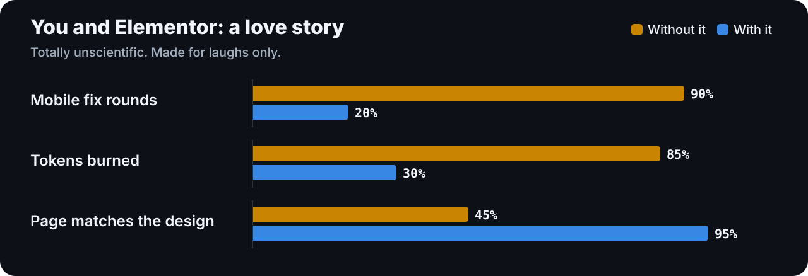

<p align="center"><b>English</b> · <a href="README.ar.md">العربية</a></p>

<p align="center"></p>

> **From HTML to Elementor, with fewer errors.** Turns an HTML file or finished design into a Draft page in Elementor through the Elementor MCP, with about 95% visual match and low token use. It builds layout and content only and never publishes the page.

## How it works

<p align="center"></p>

## Just say it

- "Build this HTML file as an Elementor page"
- "Convert this design into an Elementor page"

## The results (joking, but also not really)

<p align="center"></p>

## Install in a minute

| You use | How to install |
|---|---|
| A Claude or ChatGPT account | Download [`elementor-html-to-page.zip`](https://github.com/Marsadgrouplabs/elementor-html-to-page/releases/latest/download/elementor-html-to-page.zip) and upload it under Skills |
| Claude Code | `claude plugin marketplace add Marsadgrouplabs/elementor-html-to-page` |
| Claude Code or Codex with a script | Clone the repo and run `install.ps1` or `install.sh` |

<details>
<summary><b>Step-by-step instructions</b></summary>

### Claude or ChatGPT account

1. Download [`elementor-html-to-page.zip`](https://github.com/Marsadgrouplabs/elementor-html-to-page/releases/latest/download/elementor-html-to-page.zip) and keep it zipped.
2. **Claude:** open Skills in your account and choose to upload a file.
3. **ChatGPT:** open Skills, then Create, then Upload from your computer. Availability depends on your plan.

### Claude Code plugin

```bash
claude plugin marketplace add Marsadgrouplabs/elementor-html-to-page
claude plugin install elementor-html-to-page@marsad-elementor-html-to-page
```

### Windows

```powershell
git clone https://github.com/Marsadgrouplabs/elementor-html-to-page.git
cd elementor-html-to-page
powershell -ExecutionPolicy Bypass -File .\install.ps1
```

### macOS or Linux

```bash
git clone https://github.com/Marsadgrouplabs/elementor-html-to-page.git
cd elementor-html-to-page
bash install.sh
```

The script installs to `~/.claude/skills` for Claude Code and `~/.agents/skills` for Codex, and keeps a backup of any older copy.

</details>

## Who publishes this, and where does your data go?

Published by **[Marsad Labs](https://labs.marsadgroup.co)**. Marsad Labs is the product arm of Marsad Group, a UK-registered marketing agency, and builds practical tools for marketers and developers. [About us](https://labs.marsadgroup.co/about-us/) · [Privacy policy](https://labs.marsadgroup.co/privacy-policy/)

| Question | Answer |
|---|---|
| **What does it read?** | The design file and page data through the Elementor MCP. |
| **Does it publish on its own?** | No. The page stays a Draft, and publishing or deleting needs your approval. |
| **Does it need API keys?** | It uses your existing Elementor MCP connection. |
| **Code** | Text instructions and references only, with no scripts that run on your machine. |

This version was scanned with SkillSpector, its critical and high alerts were reviewed by hand, and client data and keys were removed. The full result, how to verify the file and how to report a problem are in [`SECURITY.md`](SECURITY.md).

## What you need

- A WordPress site with Elementor, connected through the Elementor MCP.

## Rights

All rights reserved by Marsad Labs. Copying or redistribution without permission is not allowed.

---

<p align="center">Made with love and far too much tea at <a href="https://labs.marsadgroup.co"><b>Marsad Labs</b></a></p>
